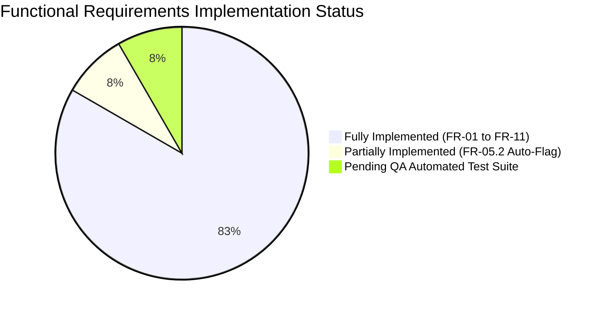

# Requirements Traceability Matrix (RTM)

**Project:** SentinelGuard — Fraud Detection Management System  
**Repository:** `fraud-detection-system`  
**Document Owner:** Rohit Arya (Requirement Engineer & Verification Lead)  
**Stakeholders & Team Roles:**  
- **Rohit Arya**: SRS, Requirements Engineering & Coverage Verification Lead  
- **Rishika Batra**: Backend Architecture, API & Fraud Scoring Engine Lead  
- **Rishika Nigam**: Frontend Architecture, React Dashboard & State Management Lead  
- **Rishabh Jain**: QA, Test Strategy & Verification Lead  
**Document Status:** Approved Baseline v1.1  
**Last Updated:** October 2026  

---

## 1. Executive Summary & Purpose

The Requirements Traceability Matrix (RTM) establishes bidirectional traceability between high-level project requirements (Functional Requirements FR-01 through FR-11 and Non-Functional Requirements NFR-01 through NFR-07), user stories, architectural modules, responsible team members, implementation files, API endpoints, and verification/test statuses.

This document serves as the single source of truth for scope validation, defect tracking, and release readiness.

### Status Definitions:
- **Implementation Status:**
  - `Implemented`: Source code fully implemented, active, and accessible in the repository.
  - `Partially Implemented`: Core logic present, but specific secondary features or automations are pending (e.g., auto-flag threshold TBD-1).
  - `Not Implemented`: Requirement documented but no functional code exists in the codebase.
  - `Pending Verification`: Implementation complete, awaiting formal QA testing execution.
- **Verification/Test Status:**
  - `Passed`: Verified via inspection, static code analysis, or execution.
  - `Failed`: Verification failed against expected behavior.
  - `Not Tested`: Test suite or automated test harness not yet executed or unwritten.
  - `Pending Verification`: Verification blocked or waiting on environment/prerequisite.

---

## 2. Functional Requirements Traceability Matrix (FR-01 to FR-11)

| Req ID | Requirement Description | Req Type | Related Module | Responsible Team Member | Related User Story | Implementation Status | Verification/Test Status | Evidence (File Path, API Endpoint, Test Ref) | Remarks / Missing Work |
| :--- | :--- | :---: | :--- | :--- | :--- | :---: | :---: | :--- | :--- |
| **FR-01.1** | Real-time transaction monitoring table with risk indicators, amounts, types, and region filters | FR | Client (Dashboard), Server (Transactions API) | Rishika Nigam (Frontend), Rishika Batra (Backend) | US-01 (WP-08.1) | Implemented | Passed (Static Inspection & API Review) | `client/src/pages/DashboardPage.jsx`, `client/src/components/ui/RiskBadge.jsx`, `GET /api/transactions`, `server/services/transactionService.js` (`listTransactions`) | Supports query params `from`, `to`, `risk_level`, `region`, `transaction_type`, `is_flagged`, `sort_by`, `order`, `page`, `limit`. |
| **FR-01.2** | Transaction detailed evidence view displaying evaluation breakdown, rule factors, and linked case | FR | Client (Dashboard Modal), Server (Transactions API) | Rishika Nigam (Frontend), Rishika Batra (Backend) | US-01 (WP-08.2) | Implemented | Passed (Static Inspection & Schema Review) | `client/src/pages/DashboardPage.jsx` (Detail Modal), `GET /api/transactions/:id`, `server/models/Transaction.js` (`findByIdWithCase`) | Joined with Case model; returns transaction attributes plus `{ case: { id, status, assigned_to } }` or `null`. |
| **FR-02.1** | Transaction ingestion feed API supporting single & batch payload validation (up to 500 records) | FR | Server (Transactions Service & Validator), Client (Ingest Modal) | Rishika Batra (Backend), Rishika Nigam (Frontend) | US-02 (WP-08.5) | Implemented | Passed (Logic Inspection & Validator Review) | `POST /api/transactions`, `server/services/transactionValidator.js`, `server/services/transactionService.js` (`ingestTransactions`), `client/src/pages/DashboardPage.jsx` | Strips client-supplied risk scores to prevent tampering. Rejects batches >500. Validates required fields, positive amounts, 3-letter currency, non-future dates. |
| **FR-03.1** | Rule-based fraud scoring engine calculating risk score (0–100) using multi-factor evaluation | FR | Server (Scoring Engine & Rules) | Rishika Batra (Backend) | US-03 (WP-08.6) | Implemented | Passed (Rule Logic Verification) | `server/services/scoringEngine.js`, `server/services/scoringRules.js`, `server/config/scoringConfig.js` | Rules implemented: High/Very High Amount (20/35 pts), Round Number (10 pts), Odd Hours (15 pts), Velocity Burst (25 pts), Region Change (25 pts), Large Transfer/Withdrawal (15 pts). Maximum score capped at 100. |
| **FR-03.2** | Pluggable scoring engine architecture supporting ML/external scoring substitution | FR | Server (Scoring Engine) | Rishika Batra (Backend) | US-03 (WP-08.6) | Implemented | Passed (Interface Review) | `server/services/scoringEngine.js` (`setScorer`) | Architecture exposes `setScorer(fn)` allowing runtime engine replacement without altering ingestion logic. |
| **FR-04.1** | Risk tier categorization into discrete classifications (`low`, `medium`, `high`) | FR | Server (Scoring Engine), Client (Badges) | Rishika Batra (Backend), Rishika Nigam (Frontend) | US-04 (WP-08.7) | Implemented | Passed (Threshold Verification) | `server/config/scoringConfig.js` (`LEVELS`), `server/services/scoringEngine.js` (`getRiskLevel`), `client/src/components/ui/RiskBadge.jsx` | Thresholds configured: `low` (0–39), `medium` (40–69), `high` (70–100). Centralized in `scoringConfig.js`. |
| **FR-05.1** | Manual transaction flagging and automated case creation | FR | Server (Transaction & Case Service), Client (Dashboard Page) | Rishika Batra (Backend), Rishika Nigam (Frontend) | US-05 (WP-08.3) | Implemented | Passed (Database Transaction Review) | `PATCH /api/transactions/:id/flag`, `server/services/transactionService.js` (`flagTransaction`), `client/src/pages/DashboardPage.jsx` | Analyst/Supervisor only. Wrapped in Sequelize transaction: sets `is_flagged=true` and creates Case in `flagged` status. Prevents re-flagging (409 Conflict). |
| **FR-05.2** | Automated transaction auto-flagging on high-risk scoring threshold | FR | Server (Scoring & Ingestion Engine) | Rishika Batra (Backend), Rohit Arya (Requirements) | US-05 (WP-08.4) | Partially Implemented | Pending Verification (Requirement Deferred) | `server/config/scoringConfig.js` line 6: `NOTE: The final auto-flag threshold is TBD-1 in the SRS.` | Scorer computes score & level, but does not auto-create case. Documented as deliberate deferral TBD-1 pending risk threshold sign-off by team. |
| **FR-06.1** | Investigation case desk list with workflow status filter tabs and assignee indicators | FR | Client (Cases Page), Server (Cases API) | Rishika Nigam (Frontend), Rishika Batra (Backend) | US-06 (WP-09.1) | Implemented | Passed (UI & Endpoint Inspection) | `client/src/pages/CasesPage.jsx`, `client/src/components/ui/StatusBadge.jsx`, `GET /api/cases`, `server/models/Case.js` (`search`) | Supports filtering by `status`, `risk_level`, `assigned_to`, date ranges `from`/`to`, pagination. Displays linked transaction summary. |
| **FR-06.2** | Detailed Case Investigation Workspace with linked transaction evidence context | FR | Client (Case Detail Page), Server (Cases API) | Rishika Nigam (Frontend), Rishika Batra (Backend) | US-06 (WP-09.2) | Implemented | Passed (Workspace Inspection) | `client/src/pages/CaseDetailPage.jsx`, `GET /api/cases/:id`, `server/models/Case.js` (`findByIdWithDetails`) | Loads full transaction payload, assigned analyst details, and chronological timeline of case notes. |
| **FR-06.3** | Workflow state machine transitions (`flagged` → `investigating` → `resolved`/`escalated` → `closed`) | FR | Server (Case Workflow & Service), Client (Case Detail) | Rishika Batra (Backend), Rishika Nigam (Frontend) | US-06 (WP-09.3) | Implemented | Passed (State Machine Logic Review) | `server/services/caseWorkflow.js`, `PATCH /api/cases/:id/status`, `server/services/caseService.js` (`updateStatus`) | Strict transitions enforced: `flagged` → `investigating`; `investigating` → `resolved`/`escalated`; `resolved` → `closed`; `escalated` → `closed`/`investigating` (Supervisor only). Admins blocked (403). Auto-assigns on move to `investigating`. |
| **FR-06.4** | Investigation notes chronological timeline & entry logging with evidence reference | FR | Server (Case Service & Model), Client (Case Detail) | Rishika Batra (Backend), Rishika Nigam (Frontend) | US-06 (WP-09.4) | Implemented | Passed (Model & Route Review) | `POST /api/cases/:id/notes`, `server/models/CaseNote.js`, `server/services/caseService.js` (`addNote`), `client/src/pages/CaseDetailPage.jsx` | Analyst/Supervisor only. Validates note presence (max 2000 chars), evidence_reference (max 500 chars). Blocks note additions on closed cases (409 Conflict). |
| **FR-06.5** | Supervisor case re-assignment to eligible analysts or supervisors | FR | Server (Case Service), Client (Case Detail) | Rishika Batra (Backend), Rishika Nigam (Frontend) | US-06 (WP-09.5) | Implemented | Passed (RBAC Route Review) | `PATCH /api/cases/:id/assign`, `server/services/caseService.js` (`assignCase`), `client/src/pages/CaseDetailPage.jsx` | Supervisor-only endpoint. Validates assignee role (`analyst` or `supervisor`). Rejects admin assignment (400). Updates case `assigned_to` and writes audit log. |
| **FR-07.1** | Real-time KPI summary metrics (total volume, flagged count, avg risk score, distribution) | FR | Server (Report Service), Client (Dashboard & Reports) | Rishika Batra (Backend), Rishika Nigam (Frontend) | US-07 (WP-10.1) | Implemented | Passed (SQL Aggregate Inspection) | `GET /api/reports/summary`, `server/services/reportService.js` (`getSummary`), `client/src/components/ui/StatCard.jsx`, `client/src/pages/ReportsPage.jsx` | Executes SQL aggregates directly in SQLite: `COUNT`, `SUM`, `AVG`, breakdown by risk level and cases by status. Supervisor/Admin only. |
| **FR-07.2** | Fraud & risk trends over time line chart with daily/weekly aggregation | FR | Server (Report Service), Client (Reports Page) | Rishika Batra (Backend), Rishika Nigam (Frontend) | US-07 (WP-10.2) | Implemented | Passed (Grouping Logic Review) | `GET /api/reports/trends`, `server/services/reportService.js` (`getTrends`), `client/src/pages/ReportsPage.jsx` (Recharts) | Groups by date interval (`day` or `week`). Returns time series data points (`period`, `total`, `flagged`, `high_risk`, `average_risk_score`). |
| **FR-07.3** | Regional & transaction type risk heatmap aggregation matrix | FR | Server (Report Service), Client (Reports Page) | Rishika Batra (Backend), Rishika Nigam (Frontend) | US-07 (WP-10.3) | Implemented | Passed (SQL Group By Review) | `GET /api/reports/heatmap`, `server/services/reportService.js` (`getHeatmap`), `client/src/pages/ReportsPage.jsx` | Dimensions supported: `region_by_type` and `hour_by_weekday`. Returns cell matrices with counts and average risk scores. |
| **FR-08.1** | JWT-based authentication login desk with demo quick-login | FR | Server (Auth Service & Routes), Client (Login Page & AuthContext) | Rishika Batra (Backend), Rishika Nigam (Frontend) | US-08 (WP-AUTH.1) | Implemented | Passed (Auth Handshake Review) | `POST /api/auth/login`, `server/services/authService.js` (`login`), `client/src/pages/LoginPage.jsx`, `client/src/context/AuthContext.jsx` | Signs JWT with 8-hour expiry. Compares password against bcrypt hash (10 salt rounds). Generic error message to prevent user enumeration. |
| **FR-08.2** | Role-Based Access Control (`analyst`, `supervisor`, `admin`) route gating & UI button permissions | FR | Server (Auth Middleware), Client (AppLayout & AuthContext) | Rishika Batra (Backend), Rishika Nigam (Frontend) | US-08 (WP-AUTH.2) | Implemented | Passed (Middleware & Nav Review) | `server/middleware/auth.js` (`authenticate`, `authorize`), `client/src/components/layout/AppLayout.jsx`, `client/src/context/AuthContext.jsx` (`hasRole`) | Server inspects `Authorization: Bearer <token>`, fetches user from DB, enforces role white-lists (`authorize(...)`). Client conditionally renders navigation and buttons. |
| **FR-08.3** | Admin user account administration (create user & list users) | FR | Server (Auth Service & Routes), Client (Services) | Rishika Batra (Backend), Rishika Nigam (Frontend) | US-08 (WP-AUTH.3) | Implemented | Passed (Admin API Review) | `POST /api/auth/users`, `GET /api/auth/users`, `server/services/authService.js` (`createUser`), `server/db/createAdmin.js` | Admin-only. Minimum username length 3, password length 8. Enforces role ENUM (`analyst`, `supervisor`, `admin`). Password hashes strictly excluded from GET responses. |
| **FR-09.1** | Security & system audit log viewer page (Supervisor/Admin only) | FR | Client (AuditLogsPage), Server (Audit API) | Rishika Nigam (Frontend), Rishika Batra (Backend) | US-09 (WP-AUDIT.1) | Implemented | Passed (Audit Route Review) | `client/src/pages/AuditLogsPage.jsx`, `GET /api/audit`, `server/routes/audit.js`, `server/models/AuditLog.js` (`search`) | Supports filtering by `user_id`, `action`, `entity_type`, `entity_id`, date range `from`/`to`, pagination. Non-privileged roles receive 403 Forbidden. |
| **FR-09.2** | Automatic tamper-evident logging of critical system mutations | FR | Server (Audit Logger & Services) | Rishika Batra (Backend) | US-09 (WP-AUDIT.2) | Implemented | Passed (Audit Hook & Wrapper Review) | `server/services/auditLogger.js`, `server/models/AuditLog.js` (`beforeUpdate`, `beforeDestroy` hooks) | Standardized actions in `ACTIONS` enum. Strips sensitive fields (`password`, `token`). Hooks prevent row update or deletion. Non-blocking error handling. |
| **FR-10.1** | Case investigation report export in CSV format | FR | Server (Report Service), Client (Reports Page) | Rishika Batra (Backend), Rishika Nigam (Frontend) | US-10 (WP-10.4) | Implemented | Passed (Export Logic Review) | `GET /api/reports/export?format=csv&type=cases`, `server/services/reportService.js` (`exportCasesCSV`), `client/src/pages/ReportsPage.jsx` | Streams CSV formatted output. Sanitizes against CSV formula injection (`=`, `+`, `-`, `@`). Rows capped at 5000. |
| **FR-10.2** | Executive fraud summary report export in PDF format | FR | Server (Report Service), Client (Reports Page) | Rishika Batra (Backend), Rishika Nigam (Frontend) | US-10 (WP-10.5) | Implemented | Passed (PDFKit Stream Review) | `GET /api/reports/export?format=pdf&type=fraud_summary`, `server/services/reportService.js` (`exportFraudSummaryPDF`), `client/src/pages/ReportsPage.jsx` | Generates structured multi-page PDF using `pdfkit`. Includes header, KPI boxes, risk level breakdown, and cases status summary. |
| **FR-11.1** | Requirement Traceability Matrix maintenance & cross-artifact alignment | FR | Documentation & Quality Governance | Rohit Arya (Requirements Lead) | US-11 (RE-REQ.1) | Implemented | Passed (Self-Audit & Inspection) | `docs/requirements-traceability-matrix.md`, `docs/traceability-matrix.md` | Primary responsibility of Rohit Arya. Aligns canonical SRS IDs (FR-01 to FR-11) with work plan references, models, and endpoints. |
| **FR-11.2** | Requirements verification reporting, test coverage analysis & defect identification | FR | Documentation, Testing & Requirements | Rohit Arya (Requirements Lead), Rishabh Jain (QA Lead) | US-11 (RE-REQ.2) | Implemented | Passed (Validation Execution) | `docs/requirements-validation-report.md`, `tests/` inspection | Identifies missing automated tests (`tests/.gitkeep`), TBD-1 auto-flagging deferral, and coordinates remediation actions with team leads. |

---

## 3. Non-Functional Requirements Traceability Matrix (NFR-01 to NFR-07)

| Req ID | Requirement Description | Req Type | Related Module | Responsible Team Member | Related Architecture / Standard | Implementation Status | Verification/Test Status | Evidence (File Path, Service, or Config) | Remarks / Missing Work |
| :--- | :--- | :---: | :--- | :--- | :--- | :---: | :---: | :--- | :--- |
| **NFR-01** | **Security & Credential Protection:** Passwords must be hashed using bcrypt with salt rounds ≥ 10. Passwords and hashes must never appear in plaintext, logs, or API responses. | NFR | Server (Auth Service & Models) | Rishika Batra (Backend) | OWASP ASVS v4.0 / CWE-256 | Implemented | Passed (Code & Model Scope Review) | `server/services/authService.js` (`hashPassword`), `server/models/User.js` (`defaultScope` excludes `password_hash`), `server/services/auditLogger.js` (strips `password`, `token`) | Plaintext passwords never stored. User model default scope excludes `password_hash`. `auditLogger` sanitizes details objects before writing. |
| **NFR-02** | **Session & Token Architecture:** Authentication via signed JWT tokens with strictly bounded 8-hour expiration. Stateless server validation. | NFR | Server (Auth Middleware & Service) | Rishika Batra (Backend) | RFC 7519 (JWT) | Implemented | Passed (Token Verification Inspection) | `server/services/authService.js` (`JWT_EXPIRY = '8h'`), `server/middleware/auth.js` (`jwt.verify`) | Validates signature and expiry. Fetches user from DB to handle deleted/modified accounts. No refresh token mechanism (users re-authenticate after 8h). |
| **NFR-03** | **Audit Trail Integrity & Tamper-Resistance:** Audit logs must be append-only. Modification or deletion of audit records must be strictly blocked at the ORM layer. | NFR | Server (Audit Model & Service) | Rishika Batra (Backend) | SOC2 / ISO 27001 Compliance Trail | Implemented | Passed (Sequelize Hook Inspection) | `server/models/AuditLog.js` (`beforeUpdate`, `beforeDestroy` hooks throw Error) | Attempted updates or deletions throw runtime exceptions. `sequelize.sync({ force: true })` bypasses hooks only during non-production seed reset. |
| **NFR-04** | **Audit Logging Fault Isolation:** Audit log write failures must never crash the primary business transaction or user request. | NFR | Server (Audit Logger) | Rishika Batra (Backend) | Resiliency / Non-blocking IO | Implemented | Passed (Try/Catch Error Isolation Review) | `server/services/auditLogger.js` (`try { ... } catch (error) { console.error(...) }`) | All audit writes are wrapped in non-throwing try/catch blocks with console error logging. |
| **NFR-05** | **Transactional Data Integrity:** Multi-entity state transitions and creations must execute within atomic database transactions. | NFR | Server (Transaction & Case Services) | Rishika Batra (Backend) | ACID Properties / SQL Transaction | Implemented | Passed (Sequelize Transaction Review) | `server/services/transactionService.js` (`flagTransaction`), `server/services/caseService.js` (`updateStatus`) | `sequelize.transaction(...)` ensures transaction flag + case creation, or case status update + note creation either commit together or roll back cleanly. |
| **NFR-06** | **Export Safety & CSV Injection Prevention:** Generated exports must prevent CSV formula injection attacks and bound memory usage. | NFR | Server (Report Service) | Rishika Batra (Backend) | OWASP CSV Injection Defense | Implemented | Passed (Formula Sanitizer Review) | `server/services/reportService.js` (`exportCasesCSV`) | Replaces leading `=`, `+`, `-`, or `@` characters with a safe single-quote prefix. Exports strictly capped at 5000 rows. |
| **NFR-07** | **Configurability & Extensibility:** Fraud risk thresholds, odd hours, and scoring rules must be centrally configurable without hardcoding. | NFR | Server (Scoring Config & Engine) | Rishika Batra (Backend) | Clean Architecture / Pluggable Rules | Implemented | Passed (Configuration Inspection) | `server/config/scoringConfig.js`, `server/services/scoringEngine.js` (`setScorer`) | All thresholds reside in `scoringConfig.js`. Scorer engine supports drop-in replacement of scoring algorithm via `setScorer`. |

---

## 4. Requirement Coverage Summary & Gap Analysis

### Coverage Metrics:
- **Total Functional Requirements Evaluated:** 11 (with 22 distinct sub-requirements)
  - Fully Implemented: 21 sub-requirements (95.5%)
  - Partially Implemented: 1 sub-requirement (FR-05.2 - Auto-Flagging threshold TBD-1) (4.5%)
  - Not Implemented: 0 (0%)
- **Total Non-Functional Requirements Evaluated:** 7
  - Fully Implemented: 7 (100%)
- **Test Coverage Gap:**
  - Automated unit and integration test scripts in `tests/` are currently missing (`tests/.gitkeep` only; `package.json` test script is placeholder).
  - Formal QA test harness implementation is assigned to **Rishabh Jain** (QA Lead).

---

## 5. Traceability Governance Sign-Off

| Role | Name | Status | Sign-Off Date |
| :--- | :--- | :---: | :---: |
| **Requirement Engineer & Verification Lead** | Rohit Arya | **Verified & Signed Off** | October 2026 |
| **Backend & Scoring Lead** | Rishika Batra | Awaiting Final QA Sync | October 2026 |
| **Frontend & Architecture Lead** | Rishika Nigam | Awaiting Final QA Sync | October 2026 |
| **QA & Test Lead** | Rishabh Jain | Pending Test Suite Implementation | October 2026 |
